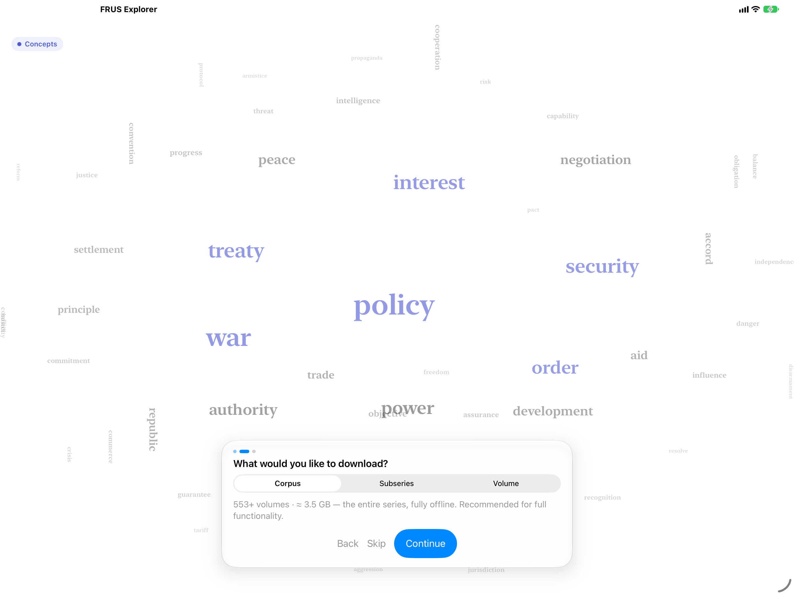
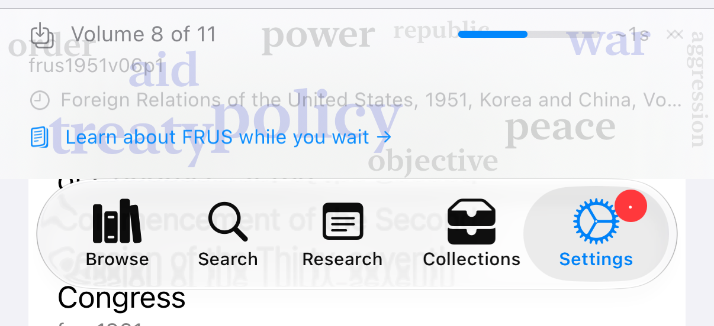
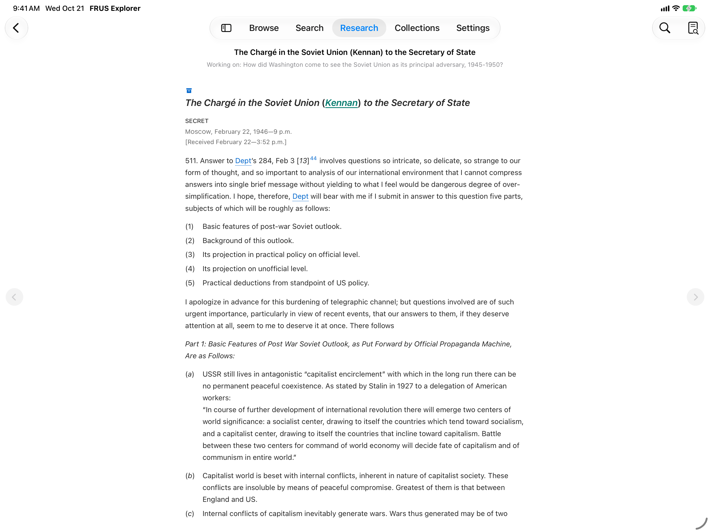
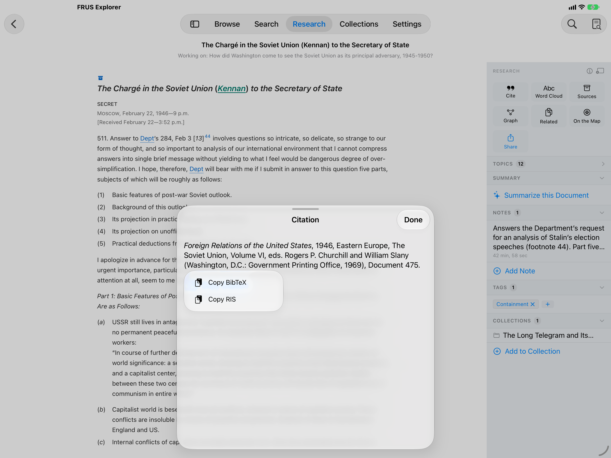
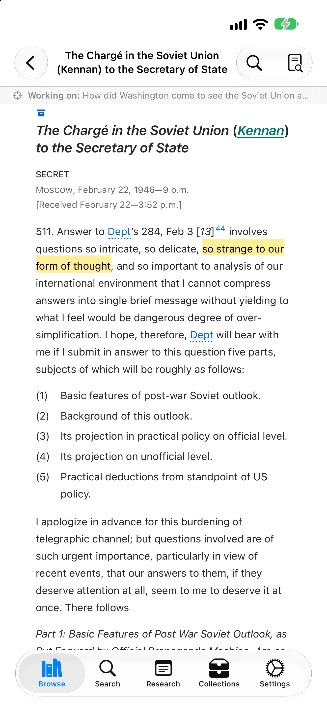
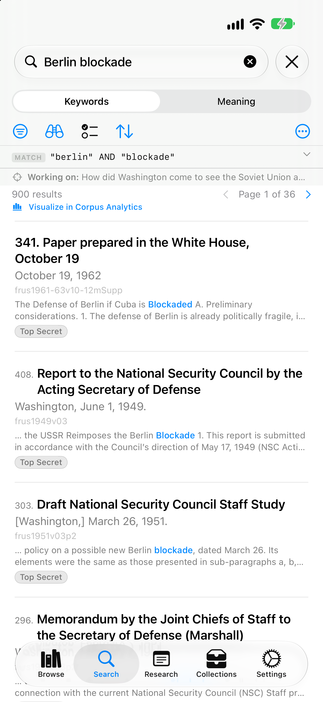

# FRUS Explorer for iPad and iPhone — Quick Start

> **AI Generated.** This guide was written for version 1.0 (build 1787) by an AI assistant (Claude), from the [user manual](iOS-User-Manual.md), the app's source and the manual's current screenshots, and has not yet been reviewed by the author.

> **Foreign Relations of the United States Explorer** — *Research the official record of U.S. foreign policy since 1861*

This guide takes you from the first launch to a document you have read, marked up, cited and traced to the archives. It is written for the **iPad**, where the app has the most room, and [section 11](#11-on-iphone) covers what is different on iPhone. Everything here is covered in depth in the [user manual for iPad and iPhone](iOS-User-Manual.md). If you work on a Mac, read the [Mac quick start](macOS-Quick-Start.md) instead.

---

## Contents

1. [Choose What to Download](#1-choose-what-to-download)
2. [Let It Index](#2-let-it-index)
3. [Find Your Way Around](#3-find-your-way-around)
4. [Open a Document](#4-open-a-document)
5. [Highlight and Take Notes](#5-highlight-and-take-notes)
6. [Open the Research Rail](#6-open-the-research-rail)
7. [Cite a Document](#7-cite-a-document)
8. [Search the Series](#8-search-the-series)
9. [Trace a Document to the Archives](#9-trace-a-document-to-the-archives)
10. [Keep Your Work Together](#10-keep-your-work-together)
11. [On iPhone](#11-on-iphone)
12. [Where to Go Next](#12-where-to-go-next)

---

## Before You Start

- **iPadOS or iOS 26 or later.** AI summaries also need a device with **Apple Intelligence** turned on; everything else works without it.
- **Storage.** One volume is a few megabytes. The whole series is about 3.5 GB to download and roughly 13 GB on the device once it is indexed for search.
- **A network connection** for the downloads. After that, reading, searching and annotating work offline.

## 1. Choose What to Download

The first launch has three steps. **Welcome** introduces the series: tap **Get Started**. **Add Volumes** asks what you would like to download:

| Choice | What it downloads |
|--------|-------------------|
| **Corpus** | All 553 volumes in the app's catalog, the whole series |
| **Subseries** | One publication era, such as *1969–76* (Nixon and Ford) |
| **Volume** | A single volume, chosen from a list by title |

**Subseries** and **Volume** open a list, and **Continue** stays dimmed until you pick a row. Tap **Continue** to start the downloads, or **Skip** to download nothing yet.

*The Add Volumes step. The word cloud behind it is drawn from the series itself, and changes to preview the era you pick.*

The last step, **Ready**, confirms what is downloading. Tap **Finish**. If you have no research project yet, the app creates one called **My Research** and makes it active ([section 10](#10-keep-your-work-together)).

> **How much to download?** The choice is not binding. A good start is the **subseries that covers your research period**; add neighboring eras later from **Settings → Library → Volumes & Storage**, where you can also remove volumes. Some of the app works before you download anything: the About the Series dashboards, the archival collection index and each volume's top subjects ship inside the app.

## 2. Let It Index

Volumes download and are indexed in the background, and you can use the app while they are. A banner along the bottom of the screen shows the volume being indexed, its place in the queue (*Volume 8 of 11*) and the time left; its chevron lists volumes still waiting to download. A dot on the **Settings** tab marks downloaded volumes not yet indexed. When the queue is done, the banner says how many volumes are ready and offers **Search →**.

*The indexing banner, shown here on iPhone above the tab bar. On iPad it runs along the bottom of the screen.*

While you wait, **Learn about FRUS while you wait →** opens the **FRUS Research Guide**: a short guide to the series, to researching with it, and to the app. When two or more volumes start indexing, the guide opens by itself the first time in a session; swipe it away and indexing carries on. Search covers each volume as soon as it has been indexed.

## 3. Find Your Way Around

The app has five tabs. On iPad they sit in a tab strip at the top of the screen, which expands into the sidebar shown below. Each tab keeps your place when you switch away.

| Tab | What it is for |
|-----|----------------|
| **Browse** | The series by subseries, volume and document, and by people, topics, administrations, editors, archives and clusters |
| **Search** | Full-text search of the volumes you have indexed, and search by meaning |
| **Research** | Everything you have marked — notes, highlights, tags — plus your reading history and the FRUS Research Guide |
| **Collections** | Ordered sets of documents with your own headings and prose, exported as PDF, HTML or Word |
| **Settings** | Volumes and storage, display, projects and tags, connections to Zotero and the National Archives, iCloud sync, About |

*The Browse tab, with the Subseries list open. Saved searches and projects appear in the sidebar under the tabs once you have some.*

At the top of **Browse**, **Continue reading** returns to the last document you had open, and the search field finds a volume by its title or number. The three buttons at the top right are the **project picker** (the folder), a filter that shows **downloaded volumes only** (the arrow), and the **Analysis Tools** menu (the chart), which opens Chronology, Corpus Analytics, the Word Cloud and the other corpus-wide tools.

## 4. Open a Document

In **Browse**, tap **Subseries**, then an era, a volume, a chapter, and a document. Each document is set from the Office of the Historian's own TEI edition: heading, classification, dateline, body and footnotes, with the names of people and the cross-references to other documents as links.

*A document in Read mode: the text alone, with faint chevrons at the screen's edges.*

- **Turn the page.** With the Research rail hidden, tap near the left or right edge of the screen for the previous or next document in the volume. However far you page, one **Back** tap leaves.
- **Find a word.** The magnifying glass at the top right is **Find in Document**.
- **With a keyboard.** ⌘F finds in the document, ⌥⌘↑ and ⌥⌘↓ go to the previous and next document, and holding **⌘** lists the rest.

## 5. Highlight and Take Notes

Select a passage with your finger, Apple Pencil or trackpad. The edit menu that appears beside it begins with the app's own actions:

- four **color dots**, each of which highlights the passage in its color;
- **Excerpt**, which keeps the passage word for word as a quotation for a collection;
- **Look Up in NARA**, which searches the National Archives catalog for the selected words;
- **Note**, which opens a research note on this document.

If an action is not on the menu's first page, tap **›**. A highlight is kept at once and syncs to your other devices through iCloud; a note is filed under your active project as well. With a keyboard, ⇧⌘N adds a note and ⇧⌘H highlights in yellow.

## 6. Open the Research Rail

The second button at the top right of a document (a page with a magnifying glass) shows and hides the **Research rail**, the panel for everything you do *about* a document. On iPad it sits beside the text; on a new install documents open with it showing.

*The Research rail beside the Long Telegram, with a note, a tag and a collection already on it.*

| Tile | What it opens |
|------|---------------|
| **Cite** | The document's citation, ready to copy ([section 7](#7-cite-a-document)) |
| **Word Cloud** | The document's vocabulary as a word cloud |
| **Sources** | Source Explorer: where the original is held ([section 9](#9-trace-a-document-to-the-archives)) |
| **Graph** | The documents this one cites and the documents that cite it |
| **Related** | A ranked list of the documents most like this one |
| **On the Map** | A map of the series that places documents by their language, centered here |
| **Share** | Sending the document to Zotero, and sharing its citation |

Below the tiles, **Topics** lists the subjects detected in the text (when there are any), **Summary** writes an on-device AI summary, and **Notes**, **Tags** and **Collections** are where you add a note, a tag, or the document to a collection. The **ⓘ** in the rail's header explains each tile, and the button beside it opens the document in a window of its own.

## 7. Cite a Document

Tap **Cite**. The citation appears in the style the Office of the Historian recommends, with **Copy Citation** for the text and **Copy as…** for BibTeX or RIS.

*The Citation sheet, with **Copy as…** open.*

Chicago and Turabian are under **Settings → Reading & Search → Display → Citation Style**. To send documents straight into your Zotero library, connect it under **Settings → System → Connections → Zotero**, then use the rail's **Share** tile.

## 8. Search the Series

Open the **Search** tab, type a query, and tap **Search** on the keyboard (or press Return). **Keywords** mode searches the words of your indexed volumes and matches their other forms, so *negotiate* also finds *negotiations*. A few forms cover most needs:

| Type | To find |
|------|---------|
| `berlin blockade` | Documents with both words, anywhere in them |
| `"long telegram"` | The words together, in that order |
| `korea OR vietnam` | Either word |
| `cold -korea` | *cold*, but not in documents that mention *korea* |
| `negoti*` | Words beginning *negoti…* |
| `=containment` | That word alone, not *contain* or *container* |

**•••** → **Search Tips** has the full list, `NEAR` included.

*A keyword search. The **MATCH** strip shows how the app read your query.*

- **Open a result** by tapping it. **Back** returns you to the results, as you left them.
- **The row of tools** under the Keywords and Meaning control holds, from the left: **Filters** (volume, date range, document type, tags), the **binoculars** (the results as a timeline, a concordance or collocates, and facets that break the whole match down), **Checklist** mode, for working through results one by one, and **Sort** (relevance or date).
- **Meaning** ranks documents by what a question means rather than by the words in it. It is experimental, and needs a one-time 310 MB download of a search model that runs on the device.
- **Save a search** with **•••** → **Save this search**. A saved search keeps its filters, syncs to your other devices, and appears in the iPad sidebar.

## 9. Trace a Document to the Archives

In the Research rail, tap **Sources**. **Source Explorer** reads the document's source note — the lot file, decimal file or presidential-library collection the original came from — and matches it, where it can, to its record in the National Archives catalog, including the entry number to give the archivists when you request the records.

*Source Explorer, resolving a lot file to its National Archives series.*

Much of this is answered offline from data that ships with the app. A free NARA Catalog API key, added under **Settings → System → Connections → NARA Catalog**, lets it look up the rest in the live catalog. **Add to Archives Visit** at the top starts a plan for a research trip ([manual §14.8](iOS-User-Manual.md#148-the-archives-visit-packet)).

## 10. Keep Your Work Together

- **The Research tab** gathers every document you have annotated, grouped by collection, tag or highlight color, with **All Notes** and **History**, the documents you have read.
- **Collections** are ordered sets of documents, with your own section headings and prose: a source packet for a paper, or a reader for a course. Tap **＋** in the **Collections** tab to make one. Add documents from the rail's **Collections** section, by touching and holding a search result, or with the editor's **＋** → **Add Documents…**, and export with the share button.
- **Projects** keep the work for each paper or course apart. The **project picker** at the top right of **Browse** switches the active project, and new notes, summaries and collections are filed under it. Make and rename projects under **Settings → Research → Projects**. A project's research question shows as the *Working on:* line in Browse and Search.

*A collection being built: the outline on the left, a preview of the export on the right.*

## 11. On iPhone

Everything above works on iPhone. A few things are arranged differently:

- The five tabs are along the **bottom** of the screen, and **Browse** shows a trail of where you are at the top.
- The **Research rail** rises as a sheet you can drag to half or full height, and it never opens by itself: tap its button when you want it.
- The graph, Related Documents and Archival Neighbors open as **sheets**, where on iPad they are windows of their own.
- In Read mode the page-turn zones at the screen's edges work the same, but are not marked.
- While volumes are indexed, a **Live Activity** shows the progress on the Lock Screen, and in the Dynamic Island on iPhones that have one.
- The **Collections** editor switches between **Outline** and **Preview**.

 

*The Long Telegram with a yellow highlight, and the same keyword search, on iPhone.*

## 12. Where to Go Next

| To learn about… | Read the manual's |
|-----------------|-------------------|
| Downloads, indexing and storage | [§5 Building Your Library](iOS-User-Manual.md#5-building-your-library) |
| Every way to browse | [§6 Browsing the Corpus](iOS-User-Manual.md#6-browsing-the-corpus) |
| Search syntax, filters, facets, saved searches and working corpora | [§7 Searching](iOS-User-Manual.md#7-searching) |
| Search by meaning | [§7.12 Search by Meaning](iOS-User-Manual.md#712-search-by-meaning-experimental) |
| Related documents and the cross-reference graph | [§8 Reading Documents](iOS-User-Manual.md#8-reading-documents) |
| Notes, highlights, tags and history | [§9 Notes, Highlights, and Tags](iOS-User-Manual.md#9-notes-highlights-and-tags) |
| Projects | [§10 Projects](iOS-User-Manual.md#10-projects) |
| Zotero and Citation Lookup | [§11 Citing and Reference Managers](iOS-User-Manual.md#11-citing-and-reference-managers) |
| Collections, excerpts and export | [§12 Collections](iOS-User-Manual.md#12-collections-research-packets-and-course-readers) |
| AI summaries | [§13 AI Summaries](iOS-User-Manual.md#13-ai-summaries) |
| Source Explorer and Archives Visits | [§14 Source Explorer](iOS-User-Manual.md#14-source-explorer-from-source-note-to-archive) |
| Charts of the whole series | [§15 Analytics](iOS-User-Manual.md#15-analytics) |
| Every setting | [§17 Settings Reference](iOS-User-Manual.md#17-settings-reference) |
| A seminar paper, a thesis, an archives trip or a course reader, start to finish | [§18 Workflows](iOS-User-Manual.md#18-workflows-for-research-and-teaching) |

---

*FRUS Explorer is an independent, private-capacity research tool. It is not an official product of the Office of the Historian or the U.S. Department of State. Any commentary, advice, or guidance about the FRUS series in this app reflects personal views about historical research methodology and makes no interpretive claims about the history of U.S. foreign policy. Those views are not necessarily those of the Department of State or the U.S. Government. The FRUS series itself is in the public domain.*
