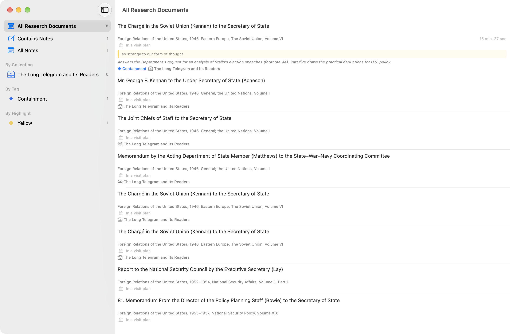

# FRUS Explorer for macOS — Quick Start

> **AI Generated.** This guide was written for version 1.0 (build 1787) by an AI assistant (Claude), from the [user manual](macOS-User-Manual.md), the app's source and the manual's current screenshots, and has not yet been reviewed by the author.

> **Foreign Relations of the United States Explorer** — *Research the official record of U.S. foreign policy since 1861*

This guide takes you from the first launch to a document you have read, marked up, cited and traced to the archives. On the Mac, documents open in the **main window**, and the tools — Search, the Corpus Browser, Source Explorer, the analytics — open in windows of their own beside it, so a search, a graph and your notes can all be on screen with the document you are reading. Everything here is covered in depth in the [user manual for macOS](macOS-User-Manual.md). If you work on an iPad or iPhone, read the [iPad and iPhone quick start](iOS-Quick-Start.md) instead.

---

## Contents

1. [Choose What to Download](#1-choose-what-to-download)
2. [Let It Index](#2-let-it-index)
3. [Know the Main Window](#3-know-the-main-window)
4. [Open a Document](#4-open-a-document)
5. [Highlight and Take Notes](#5-highlight-and-take-notes)
6. [Use the Research Rail](#6-use-the-research-rail)
7. [Cite a Document](#7-cite-a-document)
8. [Search the Series](#8-search-the-series)
9. [Trace a Document to the Archives](#9-trace-a-document-to-the-archives)
10. [Keep Your Work Together](#10-keep-your-work-together)
11. [Keyboard Shortcuts](#11-keyboard-shortcuts)
12. [Where to Go Next](#12-where-to-go-next)

---

## Before You Start

- **macOS 26 or later.** AI summaries also need an **Apple silicon** Mac with **Apple Intelligence** turned on in System Settings; everything else works without it.
- **Storage.** One volume is a few megabytes. The whole series is about 3.5 GB to download and roughly 13 to 14 GB on the Mac once it is indexed for search.
- **A network connection** for the downloads. After that, reading, searching and annotating work offline.

## 1. Choose What to Download

The first launch has three steps. **Welcome** introduces the series: click **Get Started**. **Add Volumes** asks what you would like to download:

| Choice | What it downloads |
|--------|-------------------|
| **Entire Corpus** | All 553 volumes in the app's catalog, the whole series |
| **A Subseries** | One publication era, such as *1969–76* (Nixon and Ford) |
| **A Single Volume** | One volume, chosen from a list by title |

**A Subseries** and **A Single Volume** open a list to pick from. Click **Continue** to start the downloads, or **Skip** to download nothing yet. The last step, **Ready**, confirms what is downloading: click **Finish**. If you have no research project yet, the app creates one called **My Research** and makes it active ([section 10](#10-keep-your-work-together)).

> **How much to download?** The choice is not binding. A good start is the **subseries that covers your research period**; add neighboring eras later from **Settings → Library → Volumes & Storage** (⌘,), where you can also remove volumes. Some of the app works before you download anything: the About the Series dashboards, the archival collection index and each volume's top subjects ship inside the app.

## 2. Let It Index

Volumes download and are indexed in the background, and you can use the app while they are. The **status bar** along the bottom of the main window shows the work. At its left, a green dot and the number of volumes indexed; while a queue runs, beside them, the volume being indexed and its place in the queue — *Indexing frus1951v06p1… (8/11)* — with a progress bar and the time left. Click the progress to see the queue. The chip at the right edge reports iCloud sync.

While you wait, the **Learn** button beside the progress opens the **FRUS Research Guide**, a short guide to the series, to researching with it, and to the app. It is also under **Help ▸ FRUS Research Guide**. Search covers each volume as soon as it has been indexed.

## 3. Know the Main Window

The main window is where you read. Its toolbar shows the open document's identifier in the center (`frus1946v06/d475` is volume `frus1946v06`, document 475), and five controls at the right:

| Control | Shortcut | Opens |
|---------|----------|-------|
| **Search** (magnifying glass) | ⌥⌘F | The Search window |
| **Browse** (books) | ⇧⌘B | The Corpus Browser |
| **Analytics ▾** | — | Corpus Analytics, Person Analytics, Cross-Reference Analytics, Archival Analytics, Semantic Analytics, Chronology and Word Cloud |
| **My Research ▾** | — | The Research window (⌥⌘R), Collections (⇧⌘K), Archives Visits and Complete History… |
| **Research rail** | ⇧⌘R | Shows or hides the panel beside the document |

The menu bar holds the same commands and more, in its **Document**, **Find**, **Collection**, **Analytics** and **Research** menus. **File ▸ New Window** (⌘N) opens a second main window.

## 4. Open a Document

Click **Browse** (⇧⌘B) to open the **Corpus Browser**. Its sidebar lists the ways in — **All Volumes**, **Administrations**, **Editors**, **Archives** and **Clusters**, your own scopes and corpora, and every subseries. Click a subseries, a volume, a chapter and a document, and the document opens in the main window.

*The Corpus Browser, showing a volume's page.*

Each document is set from the Office of the Historian's own TEI edition: heading, classification, dateline, body and footnotes, with the names of people and the cross-references to other documents as links.

*A document with the rail closed. The status bar is at the bottom of the window.*

- **Move through the volume** with ⌥⌘↓ (next document) and ⌥⌘↑ (previous), or the chevrons in the margins. While the Research rail is open, a bar under the text names the neighbors instead (*Doc 474*, *Doc 476*).
- **Find a word** in the document with ⌘F, then ⌘G and ⇧⌘G for the next and previous match.

## 5. Highlight and Take Notes

Select a passage. A **selection bar** appears above it, with:

- four **color dots**, each of which highlights the passage in its color;
- **Excerpt**, which keeps the passage word for word as a quotation for a collection;
- **Look Up in NARA**, which searches the National Archives catalog for the selected words;
- **Note**, which opens a research note on this document.

A highlight is kept at once and syncs to your other devices through iCloud; a note is filed under your active project as well. ⇧⌘N adds a note and ⇧⌘H highlights in yellow (the other colors are under **Document ▸ Highlight Selection**).

## 6. Use the Research Rail

The **Research rail** is the panel beside the document, for everything you do *about* a document. It is open the first time you read one; ⇧⌘R hides it and brings it back.

*The Research rail beside the Long Telegram, with a highlight in the text and a note, a tag and a collection on the rail.*

| Tile | What it opens |
|------|---------------|
| **Cite** | The document's citation, ready to copy ([section 7](#7-cite-a-document)) |
| **Word Cloud** | The document's vocabulary as a word cloud |
| **Sources** | Source Explorer: where the original is held ([section 9](#9-trace-a-document-to-the-archives)) |
| **Graph** | The documents this one cites and the documents that cite it |
| **Related** | A ranked list of the documents most like this one |
| **On the Map** | A map of the series that places documents by their language, centered here |
| **Share** | Sending the document to Zotero, and sharing its citation |

Below the tiles, **Topics** lists the subjects detected in the text (when there are any), **Summary** writes an on-device AI summary, and **Notes**, **Tags** and **Collections** are where you add a note, a tag, or the document to a collection. The **ⓘ** at the top of the rail explains each tile.

## 7. Cite a Document

Click **Cite**. A popover shows the citation, with a switch between **history.state.gov** (the style the Office of the Historian recommends), **Chicago** and **Turabian**, and buttons to **Copy citation**, **Copy URL**, or **Copy as…** BibTeX or RIS, or save a `.bib` file.

*The Citation popover, with **Copy as…** open.*

To send documents straight into your Zotero library, connect it under **Settings → System → Connections → Zotero**, then use the rail's **Share** tile.

## 8. Search the Series

Press ⌥⌘F, or click **Search** in the toolbar. The **Search** window opens with the cursor in the query field: type a query and press Return. **Keywords** mode searches the words of your indexed volumes and matches their other forms, so *negotiate* also finds *negotiations*. A few forms cover most needs:

| Type | To find |
|------|---------|
| `berlin blockade` | Documents with both words, anywhere in them |
| `"long telegram"` | The words together, in that order |
| `korea OR vietnam` | Either word |
| `cold -korea` | *cold*, but not in documents that mention *korea* |
| `negoti*` | Words beginning *negoti…* |
| `=containment` | That word alone, not *contain* or *container* |

The **Tips** button beside the field has the full list, `NEAR` included.

*The Search window, with the Facets panel open.*

- **Open a result** by clicking it. It opens in the main window, and the Search window stays as it was: tools in their own windows, documents in the main one.
- **Read the results another way.** The switch in the title bar shows them as a **List**, a **Timeline** by year, a **Concordance** (each occurrence lined up on your term) or **Collocates** (the words found near it). **Facets** breaks the whole match down by year, volume, people, document type, archival provenance and subject.
- **Narrow them.** **+ Filter** limits by date, volume, document type and more, and **Search in** chooses among documents and your own notes and summaries.
- **Meaning**, the switch at the left of the field, ranks documents by what a question means rather than by the words in it. It is experimental, and needs a one-time 310 MB download of a search model that runs on the Mac.
- **Save the search** with the bookmark button beside the field. The filled bookmark next to it lists your saved searches and runs them again.

## 9. Trace a Document to the Archives

Click **Sources** in the Research rail. **Source Explorer** opens in a window of its own and reads the document's source note — the lot file, decimal file or presidential-library collection the original came from — and matches it, where it can, to its record in the National Archives catalog, including the entry number to give the archivists when you request the records. Below the record, **Archival Neighbors** lists the other documents in your indexed volumes that come from the same archival source, so you can read a document alongside the rest of its box.

*Source Explorer, resolving a lot file to its National Archives series.*

Much of this is answered offline from data that ships with the app. A free NARA Catalog API key, added under **Settings → System → Connections → NARA Catalog**, lets it look up the rest in the live catalog. The **Add to Archives Visit** menu (the building) in its toolbar starts a plan for a research trip ([manual §14.8](macOS-User-Manual.md#148-the-archives-visit-packet)).

## 10. Keep Your Work Together

**The Research window** (⌥⌘R, or **My Research ▾ → Research**) gathers every document you have annotated, grouped by collection, tag or highlight color, with **All Notes** beside them. **My Research ▾ → Complete History…** lists everything you have read.

*The Research window.*

**Collections** (⇧⌘K) are ordered sets of documents, with your own section headings and prose: a source packet for a paper, or a reader for a course. Pick or make one with the collection menu at the left of the window's toolbar (**New Collection…** is ⌥⌘N). Add documents from the rail's **Collections** section, by right-clicking a search result, or with **＋ → Add Documents…** (⇧⌘A), and export with the share button (⇧⌘E) as PDF, HTML or Word.

*A collection: the outline, a preview of the export, and the selected document's settings.*

**Projects** keep the work for each paper or course apart. **Research ▸ Switch Project** changes the active project, and new notes, summaries and collections are filed under it. **Research ▸ New Project…** makes one, and **Research ▸ Project Home** (⇧⌘P) opens the active project's dashboard. A project's research question shows as the *Working on:* line above browsing and search results.

## 11. Keyboard Shortcuts

| Action | Shortcut |
|--------|----------|
| Open the Search window | ⌥⌘F |
| Open the Corpus Browser | ⇧⌘B |
| Find in the document / next / previous | ⌘F / ⌘G / ⇧⌘G |
| Previous / next document in the volume | ⌥⌘↑ / ⌥⌘↓ |
| Show or hide the Research rail | ⇧⌘R |
| Add a note | ⇧⌘N |
| Highlight the selection in yellow | ⇧⌘H |
| Open Citation Lookup | ⇧⌘F |
| Open the Research window | ⌥⌘R |
| Open Collections | ⇧⌘K |
| Open Project Home | ⇧⌘P |
| Print the document | ⌘P |
| Open a new main window | ⌘N |
| Open Settings | ⌘, |

The manual's [§19](macOS-User-Manual.md#19-keyboard-shortcuts) lists the rest, including the shortcuts for collections.

## 12. Where to Go Next

| To learn about… | Read the manual's |
|-----------------|-------------------|
| The main window, the menu bar and the tool windows | [§4 The Main Window and Its Windows](macOS-User-Manual.md#4-the-main-window-and-its-windows) |
| Downloads, indexing and storage | [§5 Building Your Library](macOS-User-Manual.md#5-building-your-library) |
| Every way to browse | [§6 Browsing the Corpus](macOS-User-Manual.md#6-browsing-the-corpus) |
| Search syntax, filters, facets, saved searches and working corpora | [§7 Searching](macOS-User-Manual.md#7-searching) |
| Search by meaning | [§7.11 Search by Meaning](macOS-User-Manual.md#711-search-by-meaning-experimental) |
| Related documents and the cross-reference graph | [§8 Reading Documents](macOS-User-Manual.md#8-reading-documents) |
| Notes, highlights and tags | [§9 Notes, Highlights, and Tags](macOS-User-Manual.md#9-notes-highlights-and-tags) |
| Projects | [§10 Projects](macOS-User-Manual.md#10-projects) |
| Zotero and Citation Lookup | [§11 Citing and Reference Managers](macOS-User-Manual.md#11-citing-and-reference-managers) |
| Collections, excerpts and export | [§12 Collections](macOS-User-Manual.md#12-collections-research-packets-and-course-readers) |
| AI summaries | [§13 AI Summaries](macOS-User-Manual.md#13-ai-summaries) |
| Source Explorer and Archives Visits | [§14 Source Explorer](macOS-User-Manual.md#14-source-explorer-from-source-note-to-archive) |
| Charts of the whole series | [§15 Analytics](macOS-User-Manual.md#15-analytics) |
| History and the Research Guide | [§16 History, the Research Guide, and About the Series](macOS-User-Manual.md#16-history-the-research-guide-and-about-the-series) |
| Every setting | [§17 Settings Reference](macOS-User-Manual.md#17-settings-reference) |
| A seminar paper, a thesis, an archives trip or a course reader, start to finish | [§18 Workflows](macOS-User-Manual.md#18-workflows-for-research-and-teaching) |

---

*FRUS Explorer is an independent, private-capacity research tool. It is not an official product of the Office of the Historian or the U.S. Department of State. Any commentary, advice, or guidance about the FRUS series in this app reflects personal views about historical research methodology and makes no interpretive claims about the history of U.S. foreign policy. Those views are not necessarily those of the Department of State or the U.S. Government. The FRUS series itself is in the public domain.*
